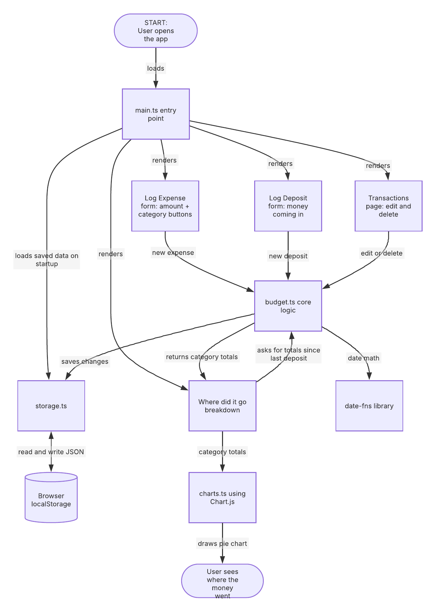

# College Budget App

A fast budgeting web app built for college students, so you always know where your money went.

## Project Goal

When I get money in college, it's often gone within a week, and I end up scrolling through my bank transactions trying to figure out where it all went. Most budgeting apps are built for adults with steady paychecks and bills like rent and car payments, so they don't match how college students actually spend: lots of small, frequent purchases like dining out with friends, scooter rides, and snacks.

This app makes logging an expense take a few seconds and shows a clear breakdown of where money went since the last time money came in.

## MVP Scope (Version 1.0)

- **Fast expense logging:** enter an amount and tap a category; the date fills in automatically
- **Log money coming in:** record deposits like "got $300 from parents"
- **College categories in groups:** Food, Getting Around, School, Personal, Fun, Essentials
- **"Where did it go" breakdown:** spending by category since the last deposit
- **Transactions page:** view, edit, and delete expenses
- **Saved in the browser:** data persists with localStorage

## Future Plans (Version 2.0+)

- Safe to Spend today + pace warnings
- Auto-category memory (type "Chipotle" once, it's Dining Out after that)
- Tags like #with-friends
- Type-to-log: "12.50 chipotle" becomes an expense
- Compare months and view spending history
- Backend + login to sync between phone and laptop
- AI-powered logging

## Tech Stack

| Area | Tool |
| --- | --- |
| Language | TypeScript |
| Markup and styling | HTML, CSS |
| Data storage | Browser localStorage |
| Charts | Chart.js |
| Date math | date-fns |
| Icons | Lucide |
| CSV export | PapaParse |
| Dev server and build | Vite, Node.js, npm |
| Version control and hosting | Git, GitHub, GitHub Pages |

## Project Structure

```
college-budget-app/
├── docs/                  # Design documents
│   ├── eisenhower-matrix.pdf
│   └── system-diagram.png
├── public/                # Static files served as-is
├── src/
│   ├── main.ts            # Entry point: loads data and renders pages
│   ├── types.ts           # Expense, Deposit, and Category types
│   ├── budget.ts          # Core logic: add, edit, delete, totals
│   ├── storage.ts         # Save and load from localStorage
│   ├── charts.ts          # Spending charts with Chart.js
│   └── style.css          # Styles
├── tests/                 # Tests for the core logic
├── index.html
├── package.json
├── tsconfig.json
└── README.md
```

## Design Docs

- [Eisenhower Matrix](docs/eisenhower-matrix.pdf)
- System Diagram:



## Running Locally

```bash
npm install
npm run dev
```

Then open the local link that Vite prints in the terminal.

## Build Plan

1. Set up the project and deploy a "Hello" page
2. Define the data types and core logic
3. Save and load data with localStorage
4. Build fast expense logging
5. Add money coming in
6. Build the transactions page
7. Build the "where did it go" breakdown
8. Add charts with Chart.js
9. Polish and ship
